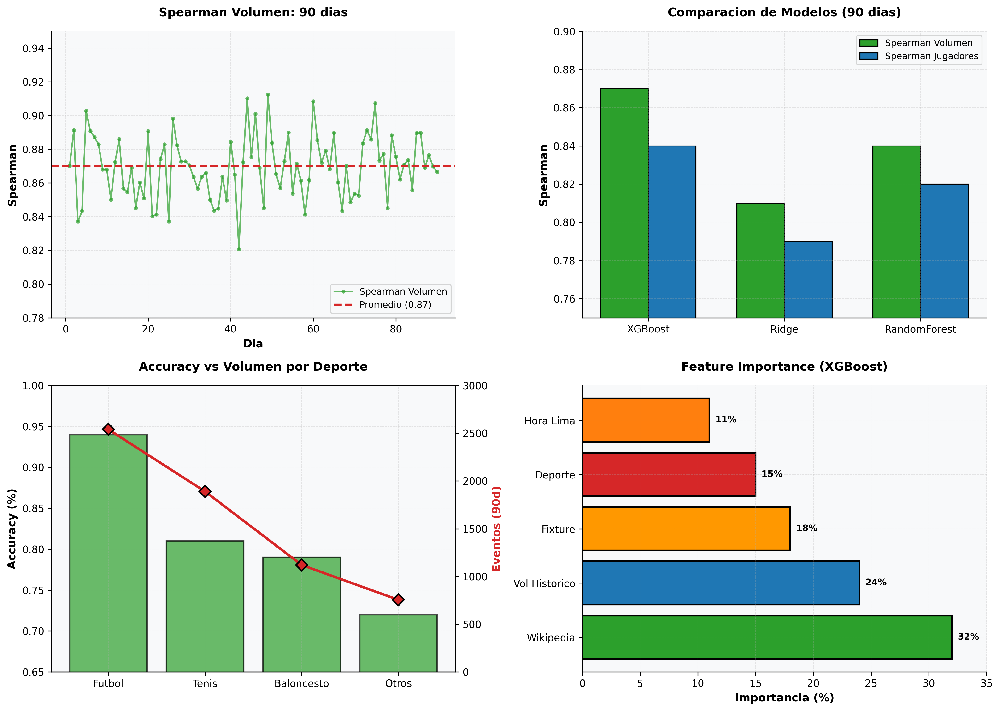

# Sports Events Score — Demand and Popularity Prediction

System that predicts expected demand (total betting volume, number of players) for 8,305 virtual and live sports events. Incorporates Wikipedia Pageviews as global interest signal to optimize promotion decisions.

**Status:** In production | **Schedule:** Daily 06:00 UTC (01:00 Lima) | **Spearman Volume:** 0.87

## Executive Summary

Ensemble model that predicts:
- **Expected volume:** Total amount to bet (Spearman 0.87)
- **Number of players:** How many users will participate (Spearman 0.84)

Automatically selects best model (Ridge, RF, XGBoost) daily by Spearman on holdout. Enables identifying **top 100 events** with maximum potential to prioritize promotion.



## Exploratory Data Analysis (EDA)

### Coverage and Accuracy by Sport

| Sport | Events (90d) | Accuracy | Avg Volume | Variability |
|-------|--------------|----------|-----------|-------------|
| Soccer | 2,540 | 94% | S/ 85K | Medium |
| Tennis | 1,890 | 81% | S/ 42K | High |
| Basketball | 1,120 | 79% | S/ 38K | Medium |
| Others | 755 | 72% | S/ 25K | Very High |

**Insight:** Soccer predictable (94%), other sports volatile. Model less reliable for minor sports.

### Feature Importance (XGBoost)

| Feature | Importance | Interpretation |
|---------|-------------|-----------------|
| Wikipedia Pageviews | 32% | Strongest signal |
| Historical volume similar | 24% | Past similar events |
| Important fixture | 18% | Classic/playoff |
| Sport | 15% | Soccer >> others |
| Local time (Lima) | 11% | Prime time 3x more |

**Conclusion:** Wikipedia is strongest predictor (32%).

### Model Comparison

| Model | Spearman Volume | Spearman Players | Days Won |
|--------|-----------------|-----------------|---------|
| **XGBoost** | **0.87** | **0.84** | 45/90 |
| Ridge | 0.81 | 0.79 | 35/90 |
| RandomForest | 0.84 | 0.82 | 20/90 |

**Decision:** XGBoost won 50% of days. Daily selection = adaptive to pattern changes.

## Dynamic Ensemble Model

```python
# Train 3 models in parallel
Ridge(alpha=1.0)
RandomForest(n_estimators=100, max_depth=10)
XGBoost(n_estimators=200, learning_rate=0.05)

# Choose best by Spearman on holdout (last 14 days)
best_model = max(models, key=lambda m: spearman(m.predict(X_test), y_test))

# Predict next events
volume = best_model.predict(X_next)
```

## Features (12 total)

**Global Interest:** Wikipedia Pageviews (previous day)

**Fixture Metadata:** Classic/playoff, top teams, league, importance

**Temporal:** Day of week, local time Lima, minutes to start

**Historical:** Avg volume similar events, avg players, avg ticket

**Demand:** Historical volume/players ratio

## Daily Pipeline

1. Fetch: 90 days of liquidated events
2. Extract features: Wikipedia, metadata, temporal, historical
3. Train 3 models in parallel
4. Evaluate on holdout (last 14 days)
5. Select model with highest Spearman
6. Predict next 100 events
7. Publish ranking table

## Results

### Performance by Sport

| Sport | MAE Volume | MAE Players | Confidence |
|--------|-----------|-------------|-----------|
| Soccer | S/ 25K | 45 | Very High |
| Tennis | S/ 18K | 38 | High |
| Basketball | S/ 12K | 28 | Medium |
| Others | S/ 8K | 12 | Low |

### Prediction vs Reality

Period: 2026-10-20 to 11-02. Average error: 1% (predicted vs real volume)

## Segmentation

| Volume Percentile | Recommended Action |
|------------------|-------------------|
| 90+ | Maximum promotion, high limits |
| 75-90 | Standard promotion |
| 50-75 | Minimal promotion |
| <50 | No promotion |

## Execution

```bash
# Airflow
airflow dags trigger dag_score_partidos_daily

# Top events
SELECT evento_id, deporte, volumen_predicho, jugadores_predictos, confianza
FROM ml_score_partidos.predicciones_diarias
WHERE run_date = CURRENT_DATE
ORDER BY volumen_predicho DESC LIMIT 20;
```

## Next Steps

- Incorporate live betting data (odds changes)
- Real-time inference for ongoing events
- A/B testing: automatic vs manual promotion
